# 12Sky in-game help — full transcription (31 pages)

Every page of the 12Sky help, in page order, with the original screenshot under each heading (`pages~/12sky_page_NN.jpg`; the `~` suffix keeps Unity from importing them as textures). Text is written in Krytical Nova terms with the reference term in brackets, so the owner can read it by the Twelve Sky name: for example "Tempering [Item Upgrade]" or "Crew [Guild]". The Glossary in `01_Systems_Build_List.md` is the full key.

## Pages 1–6: NPCs, stats, controls, chat

### Page 1: Main NPC details (Ronyan Fortress town map)

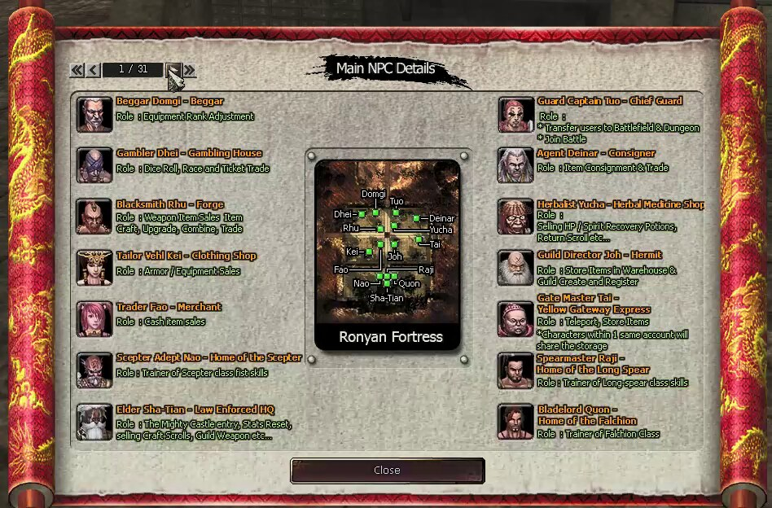

Each Home City [fortress] has 14 NPCs, each with a locate-on-map marker. Krytical Nova role in bold; the Zone01 seed already has Apothecary, Armorer, two Instructors, Broker, Store Clerk, Marshal and Fixer.

| 12Sky NPC | Krytical Nova role | Role |
| --- | --- | --- |
| Beggar Domgi | **Fixer** | Gear rank adjustment (up / down) |
| Gambler Dhei | **Bookie** (not planned) | Dice roll, race and ticket trade |
| Blacksmith Rhu (Forge) | **Armorer** | Weapon sales, crafting, Tempering, Fusion, trade |
| Tailor Vehl Kei (Clothing Shop) | **Outfitter** | Armor / equipment sales |
| Trader Fao (Merchant) | **Store Clerk** | Nova Store item sales (cash items) |
| Scepter Adept Nao | **Instructor** (Scepter) | Trainer for Scepter weapon skills |
| Elder Sha-Tian (Law Enforced HQ) | **Chancellor** | Castle entry, stat reset, Dossier crafting, Siege Rigs |
| Guard Captain Tuo (Chief Guard) | **Marshal** | Transfers players to battlefield and Runs; join battle |
| Agent Deinar (Consigner) | **Broker** | The Exchange (consignment) and trade |
| Herbalist Yucha (Herbal Medicine Shop) | **Apothecary** | Sells HP / Flux Stims, Recall Tags |
| Guild Director Joh (Hermit) | **Vaultkeeper** | Vault storage, Crew create and register |
| Gate Master Tai (Yellow Gateway Express) | **Wayfinder** | Transit, Deep Vault; all characters on one account share it |
| Spearmaster Raji | **Instructor** (Long Spear) | Trainer for Long Spear skills |
| Bladelord Quon | **Instructor** (Blade) | Trainer for Blade [Falchion] skills |

### Page 2: Ability / stat distribution

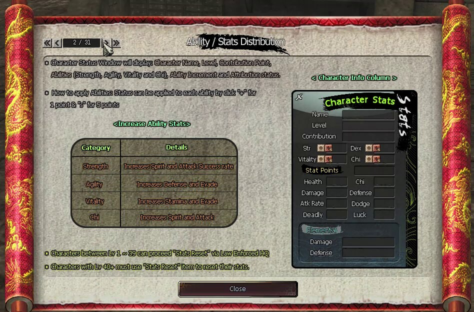

The Character Sheet shows name, level, Renown [Contribution Point], the four base stats, stat points and derived stats. Click + for 1 point or 5 for 5 points.

| Base stat | Raises |
| --- | --- |
| Strength | Flux [Spirit pool] and Hit Rate [Attack Success rate] |
| Agility | Defense and Evasion [Evade] |
| Vitality | HP [Stamina] and Evasion |
| Spirit [Chi] | Flux and Attack |

Derived stats on the sheet: Health, Flux [Chi], Damage, Defense, Hit Rate [Atk Rate], Evasion [Dodge], Critical [Deadly], Luck, Elemental damage, Elemental defense.

Levels 1–39 can reset stats at the Chancellor [Law Enforced HQ]; level 40+ must use a Respec Chip [Stats Reset item].

### Page 3: Mouse control

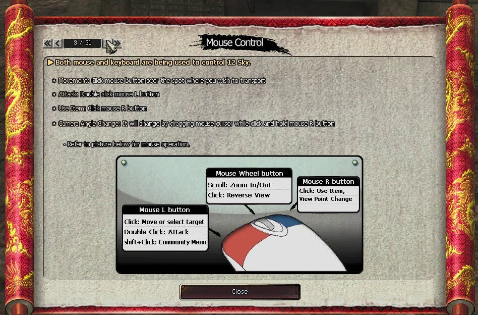

- Move: click the ground where you want to go.
- Attack: double-click left on a target.
- Use item: right-click.
- Camera: hold right button and drag.
- Wheel: scroll zooms; wheel-click reverses the view.
- Shift + left-click on a player opens the community menu (duel, trade, friend, teacher, party, guild).

### Page 4: Keyboard shortcuts

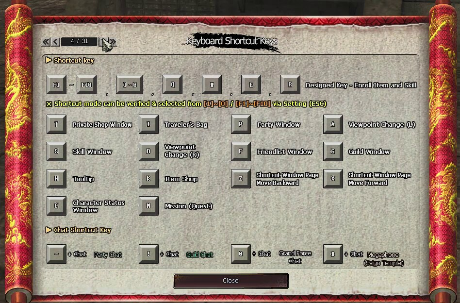

Hotbar [Shortcut Window] keys are F1–F10, 1–0, Q, W, E, R; the Hotbar mode (1–0 vs F1–F10) is chosen in Settings (ESC).

| Key | Window |
| --- | --- |
| T | Kiosk [Private Shop] |
| I | Pack [Traveler's Bag] |
| P | Squad [Party] |
| A | Camera rotate left |
| S | Skills |
| D | Camera rotate right |
| F | Contacts [Friend list] |
| G | Crew [Guild] |
| H | Tooltip |
| K | Nova Store [Item Shop] |
| Z / X | Hotbar page back / forward |
| C | Character Sheet |
| M | Contracts [Mission / Quest] |

Chat prefixes: ~ Squad, ! Crew, @ Faction [Grand Force], # Hailer [megaphone] (Central Plaza only).

### Page 5: Keyboard basic control

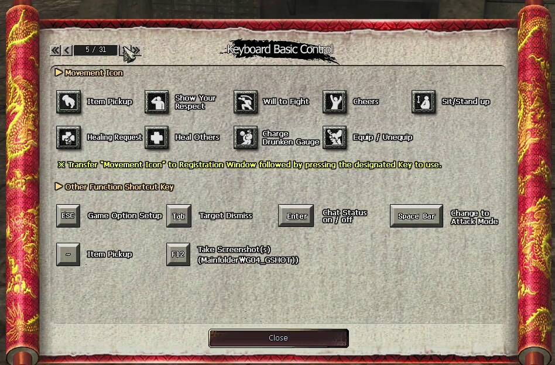

Action icons [Movement Icons] that can be dragged into the registration window and bound to a key: Item pickup, Show respect, Will to fight (combat stance), Cheers, Sit / stand, Healing request, Heal others, Charge drunken gauge, Equip / unequip.

Fixed keys: ESC settings, Tab dismiss target, Enter chat on/off, Space attack mode, ~ item pickup, F12 screenshot.

### Page 6: Chat

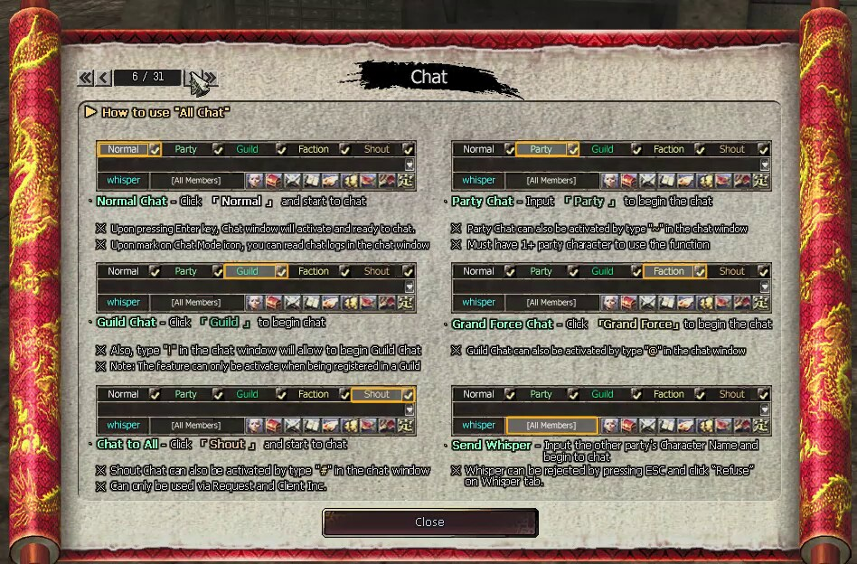

Channels: Normal, Squad, Crew, Faction, Broadcast [Shout], Whisper. Enter activates the chat line; marking a channel tab filters the log. Squad chat needs 1+ Squad member; Crew chat needs Crew membership; Broadcast is request/client-side only. Whisper: type the target name; the target can reject with ESC then Refuse.

## Pages 7–10: gear tiers, combat skills, skill management

### Page 7: Item tier and item use

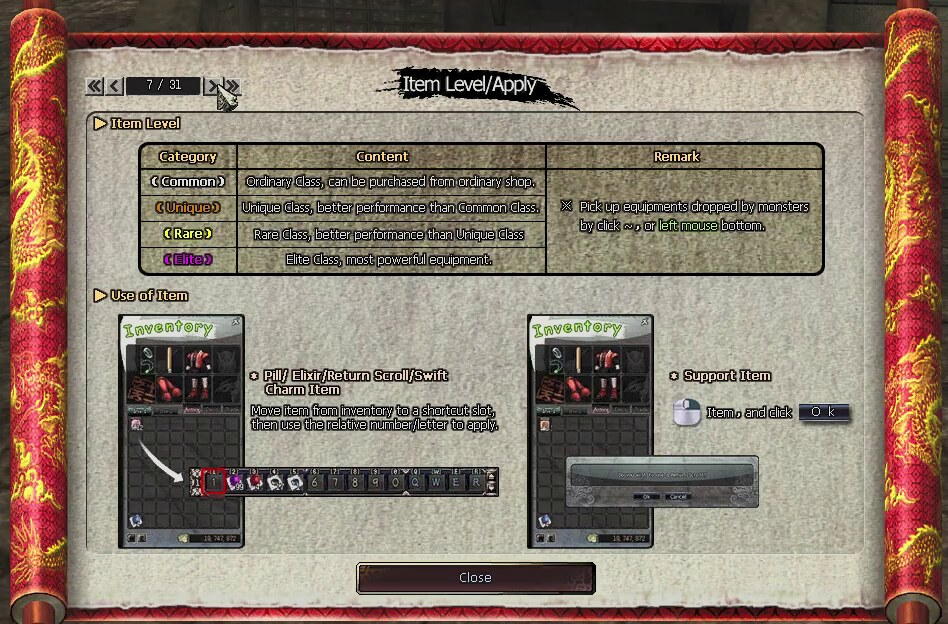

| Krytical Nova rarity [12Sky] | Description |
| --- | --- |
| Common [Common] | Ordinary, sold in shops |
| Uncommon [Unique] | Better than Common |
| Rare [Rare] | Better than Uncommon |
| Epic [Elite / Epic] | Most powerful (Legendary is reserved above it) |

Hostiles [mobs] drop gear; pick it up with ~ or left-click. Stims, Recall Tags and charms [pills, elixirs, return scrolls] go on the Hotbar and fire by key. Support items are used by selecting then confirming OK.

### Page 8: Faction-shared combat skills [Martial Art Type 1]

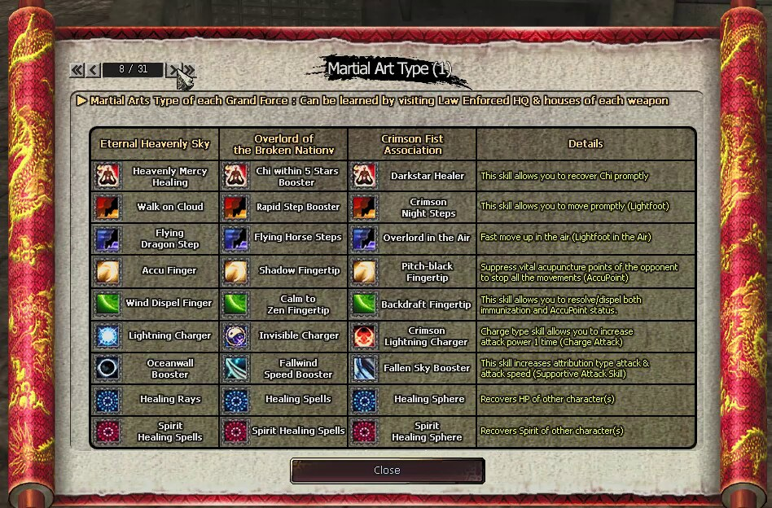

Learned at the Chancellor [Faction HQ] or each weapon Instructor. Each of the three 12Sky factions has its own named version of the same nine utility skills; in Krytical Nova these map onto the Tier 1 / Tier 2 skills already in `SkillDefinitionSO` (Heavenly Serenity, Azure Wall, Finger of Darkness, Spirit's Return, Raising the Dead and so on):

| Skill effect | Eternal Heavenly Sky | Overlord of the Broken Nation | Crimson Fist Association |
| --- | --- | --- | --- |
| Recover mana quickly | Heavenly Mercy Healing | Chi within 5 Stars Booster | Darkstar Healer |
| Move quickly (lightfoot) | Walk on Cloud | Rapid Step Booster | Crimson Night Steps |
| Fast move in the air | Flying Dragon Step | Flying Horse Steps | Overlord in the Air |
| Paralyze target (AccuPoint) | Accu Finger | Shadow Fingertip | Pitch-black Fingertip |
| Dispel immunity and paralysis | Wind Dispel Finger | Calm to Zen Fingertip | Backdraft Fingertip |
| Charge attack: 1 big hit | Lightning Charger | Invisible Charger | Crimson Lightning Charger |
| Elemental attack + attack speed buff | Oceanwall Booster | Fallwind Speed Booster | Fallen Sky Booster |
| Heal others' HP | Healing Rays | Healing Spells | Healing Sphere |
| Heal others' mana | Spirit Healing Spells | Spirit Healing Spells | Spirit Healing Sphere |

### Page 9: Registering, leveling and discarding skills

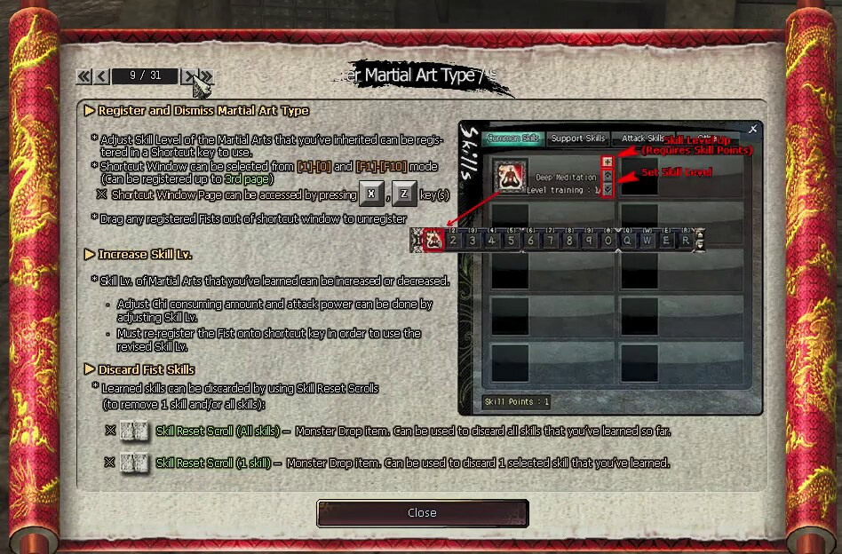

- Learned skills are dragged onto the Hotbar; Hotbar mode is 1–0 or F1–F10, up to 3 pages, X / Z to page. Drag a skill off the Hotbar to unregister it.
- Skill level can be raised or lowered with skill points (the + and - next to the skill in the Skills window); level changes Flux cost and attack power. A skill must be re-registered on the Hotbar after its level changes.
- Memory Wipe (all skills) and Memory Wipe (1 skill) [Skill Reset Scrolls] are Hostile drops that discard learned skills.
- Skills window tabs: Common, Support, Attack.

### Page 10: Weapon attack skills [Martial Arts 2], Jinong faction example

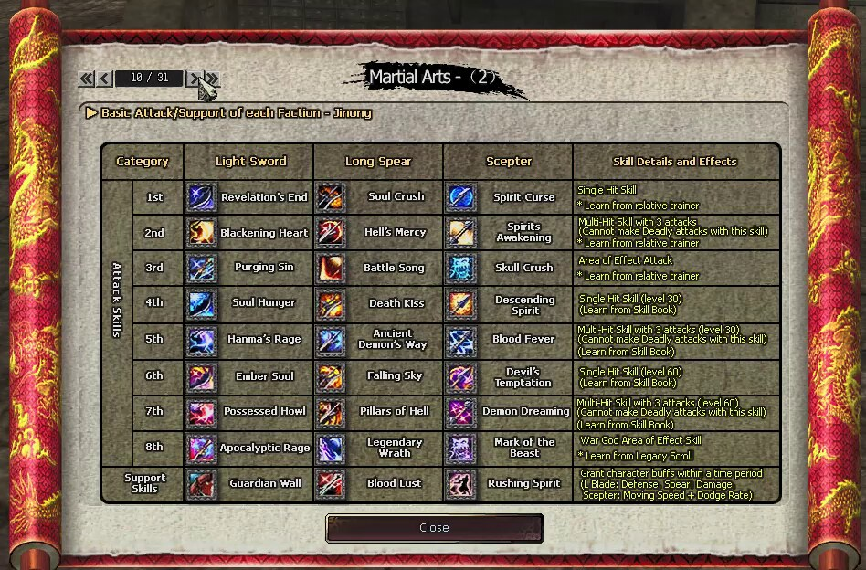

Every weapon has the same 8-slot attack kit plus 1 support buff. The slot pattern is the template for the 8 remaining weapon lines; source column uses Krytical Nova items (Instructor, Skill Chip [skill book], Dossier [legacy scroll]):

| Slot | Light Sword | Long Spear | Scepter | Type and source |
| --- | --- | --- | --- | --- |
| 1st | Revelation's End | Soul Crush | Spirit Curse | Single hit; Instructor |
| 2nd | Blackening Heart | Hell's Mercy | Spirits Awakening | 3-hit multi, no Critical; Instructor |
| 3rd | Purging Sin | Battle Song | Skull Crush | AoE; Instructor |
| 4th | Soul Hunger | Death Kiss | Descending Spirit | Single hit; Skill Chip, level 30 |
| 5th | Hanma's Rage | Ancient Demon's Way | Blood Fever | 3-hit multi, no Critical; Skill Chip, level 30 |
| 6th | Ember Soul | Falling Sky | Devil's Temptation | Single hit; Skill Chip, level 60 |
| 7th | Possessed Howl | Pillars of Hell | Demon Dreaming | 3-hit multi, no Critical; Skill Chip, level 60 |
| 8th | Apocalyptic Rage | Legendary Wrath | Mark of the Beast | War God AoE; Dossier |
| Support | Guardian Wall (defense) | Blood Lust (damage) | Rushing Spirit (move speed + Evasion) | Timed self-buff |

## Pages 11–14: Siege Nights, Callouts, Trade, Kiosks

### Page 11: Siege Nights [Regular Warfare]

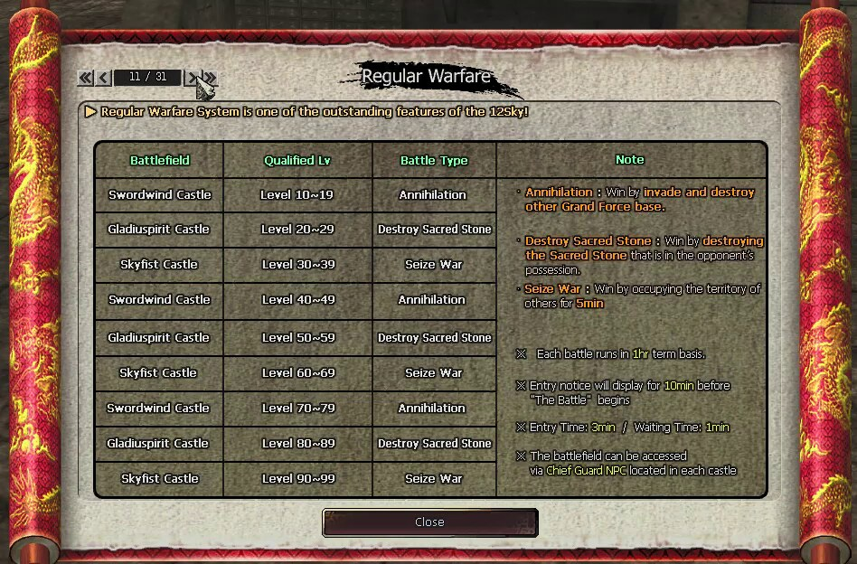

| Battlefield (12Sky castle) | Level bracket | Krytical Nova battle type [12Sky] |
| --- | --- | --- |
| Swordwind Castle | 10–19, 40–49, 70–79 | Siege Night [Annihilation]: invade and destroy the other faction's base |
| Gladiuspirit Castle | 20–29, 50–59, 80–89 | Beacon War [Destroy Sacred Stone]: destroy the Beacon the opponent holds |
| Skyfist Castle | 30–39, 60–69, 90–99 | Turf War [Seize War]: hold the territory for 5 minutes |

Each battle runs on a 1-hour cycle. Entry notice shows 10 minutes before the battle; entry window 3 minutes, waiting time 1 minute. Enter through the Marshal [Chief Guard] in each Home City.

### Page 12: Callouts [PvP System / Duel]

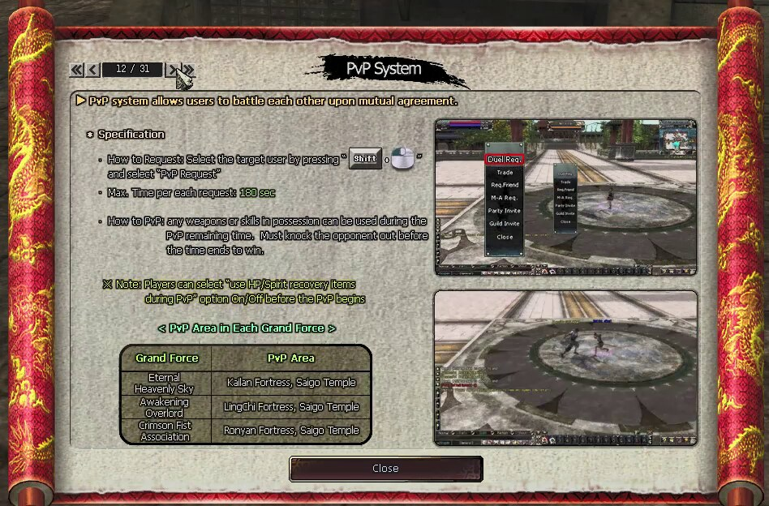

- Request: Shift + click the target, choose Callout [Duel Request]. Mutual agreement required.
- Max 180 seconds per Callout. Any weapon or skill allowed. Knock the opponent out before time ends to win.
- Before the Callout, players can toggle "use HP / Flux Stims during PvP" on or off.
- Callout areas: each faction's Home City [Kailan, LingChi, Ronyan fortresses] and the Central Plaza [Saigo Temple].

### Page 13: Trade

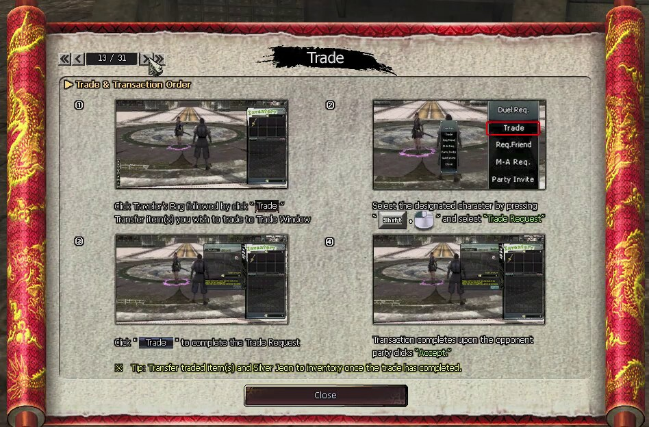

1. Open the Pack, click Trade, move the items you want to trade into the trade window.
2. Shift + click the other player and choose Trade Request.
3. Click Trade to send the request.
4. Trade completes when the other party clicks Accept.

Traded items and Creds [Silver Jeon] land in the Pack after completion.

### Page 14: Kiosks [Private Shop]

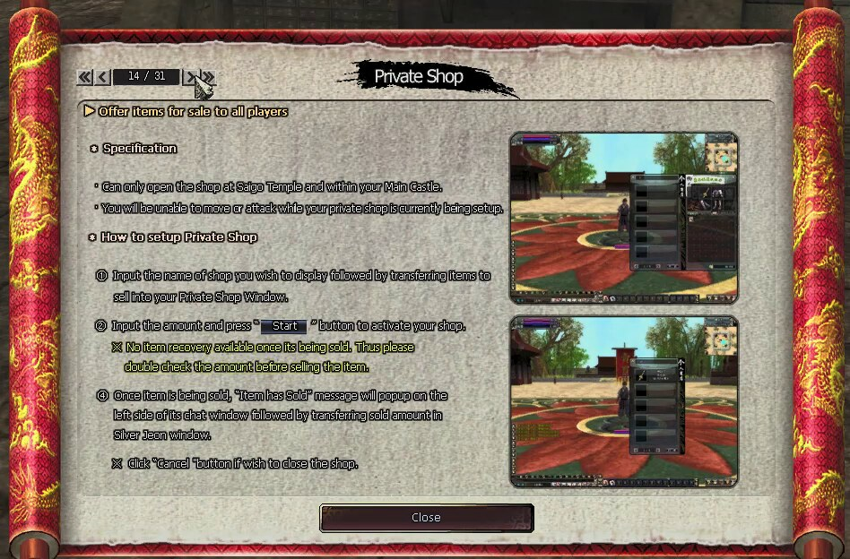

- A Kiosk [Private Shop] can only be opened in the Central Plaza and your faction's Home City.
- You cannot move or attack while your Kiosk is open.
- Setup: enter a shop name, drag items into the Kiosk window, enter a price per item, press Start.
- No take-back once an item is sold; double-check prices before starting.
- On sale, an "Item has Sold" message appears in chat and the Creds are credited to your wallet.
- Cancel closes the Kiosk.

## Pages 15–21: hunting, Contacts, Squad, XP, Sponsor / Recruit, Vaults

### Page 15: Hunting, beginner guide

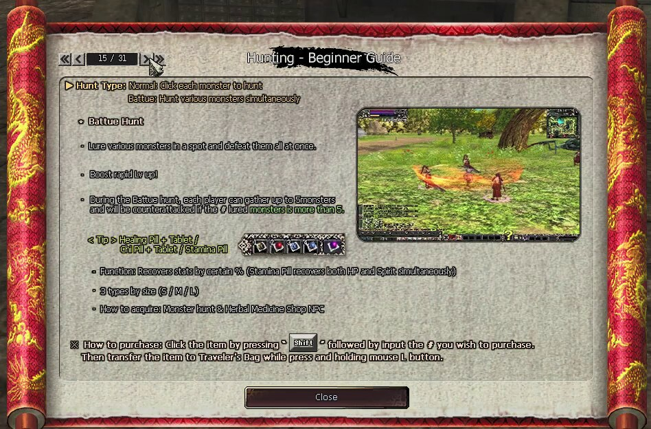

- Normal hunt: click each Hostile [monster]. Sweep [Battue hunt]: lure several Hostiles to one spot and kill them together for fast leveling.
- Each player can gather up to 5 Hostiles; more than 5 and they counter-attack.
- Consumables: HP Stim [Healing pill / tablet], Flux Stim [Chi pill / tablet], Dual Stim [Stamina pill, both]. Recover a set %. Sizes S, M, L. From Hostile drops or the Apothecary [Herbalist].
- Buying: Shift + click the item, type the quantity, drag to the Pack.

### Page 16: Contacts [Friend list]

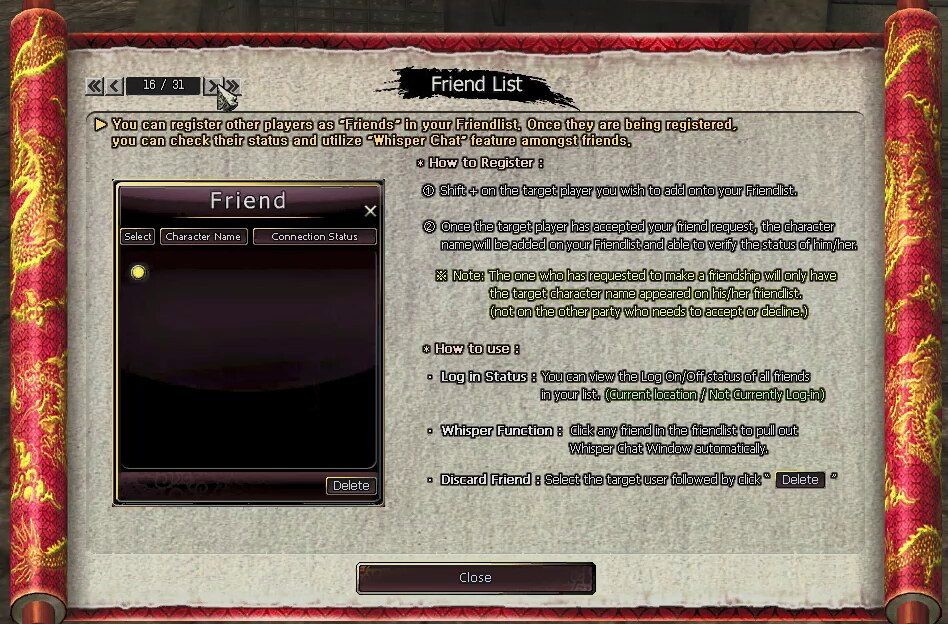

- Contacts [Friend list]: Shift + click a player, send Contact Request; on accept, the name is added. Only the requester gets the entry, not the acceptor.
- Shows online / offline and current location.
- Click a Contact to open a whisper window. Delete removes them.

### Page 17: Squad hunting [Party]

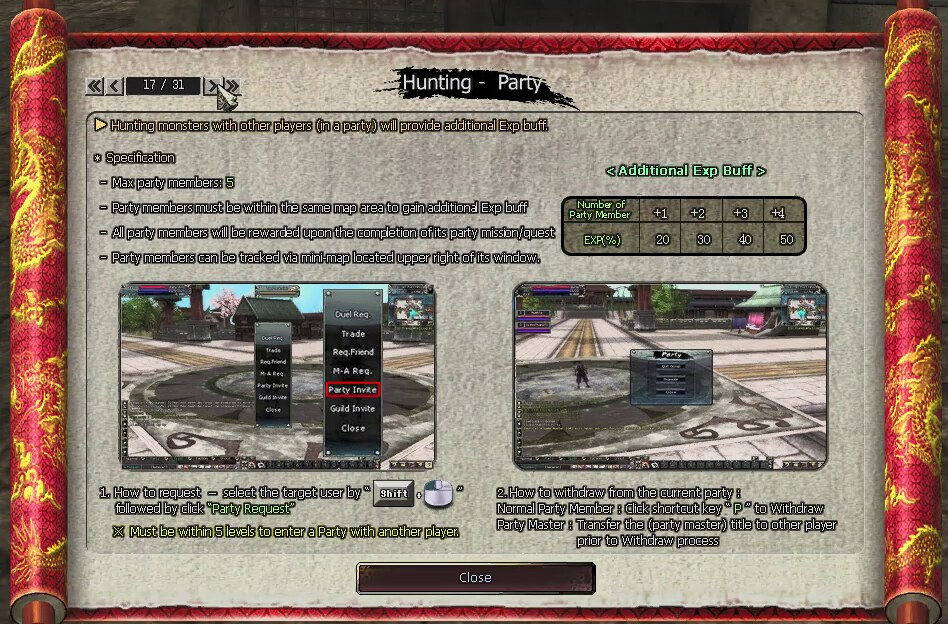

- Squad [Party]: max 5 members; must be within 5 levels to join.
- XP bonus only while members are on the same map: +1 member 20%, +2 30%, +3 40%, +4 50%.
- All members are rewarded on Squad Contract [party quest] completion. Members shown on the mini-map.
- Invite: Shift + click, Squad Invite. Leave: press P. Leader must transfer leadership before leaving.

### Page 18: Level and XP

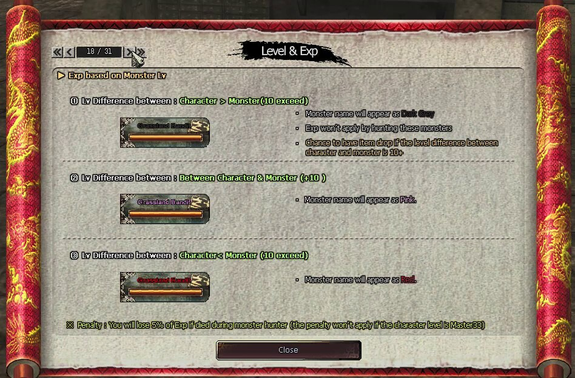

| Level gap | Hostile name colour | Effect |
| --- | --- | --- |
| Character 10+ above Hostile | Dark grey | No XP; item drops only possible when the gap is 10+ (as written on the page) |
| Within 10 levels | Pink | Normal |
| Hostile 10+ above character | Red | Dangerous |

Death penalty: lose 5% XP on death while hunting; no penalty from Prime 33 [Master 33] up.

### Page 19: Sponsor / Recruit [Mentor system]

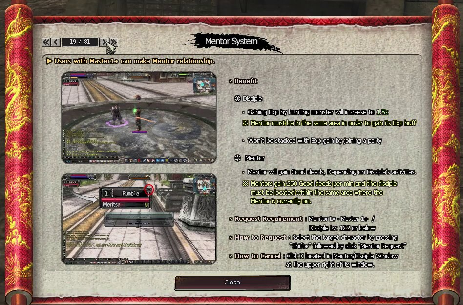

- Sponsor [Mentor] must be Prime 1+ [Master 1+]; Recruit [Disciple] must be level 122 or below.
- Recruit gains 1.5x XP from Hostiles while the Sponsor is in the same area; does not stack with Squad XP.
- Sponsor earns 250 Sponsor points [Good deeds] per minute while the Recruit is in the same area.
- Request: Shift + click, Sponsor Request. Cancel: X in the Sponsor / Recruit window.

### Page 20: Vault [Storage], per character

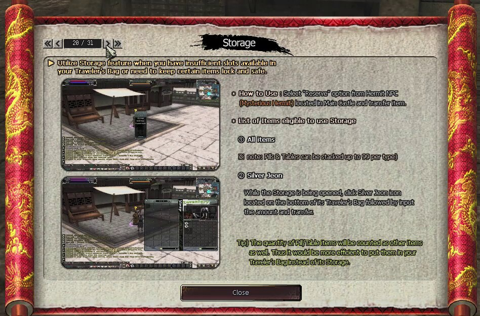

- Vault [Storage]: Vaultkeeper [Hermit NPC] in the Home City, option Reserve; drag items in.
- Takes all items; Stims stack to 99. Creds: click the Creds icon at the bottom of the Pack, enter an amount, transfer.
- Stim stacks count as items, so keep them in the Pack rather than the Vault.

### Page 21: Deep Vault [Warehouse], shared across characters

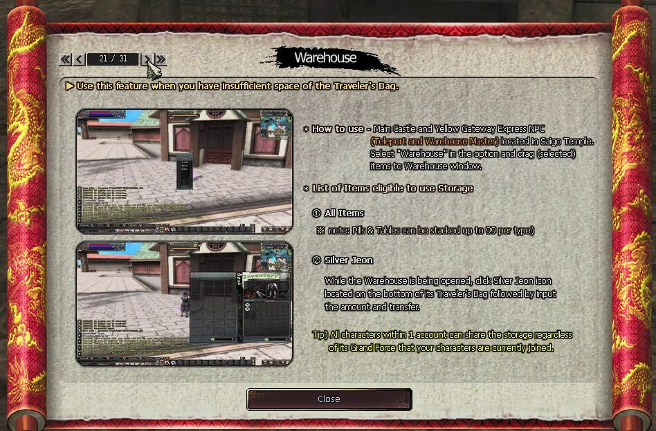

- Deep Vault [Warehouse]: Wayfinder [Teleporter NPC] in the Home City and the Central Plaza, option Warehouse; drag items in.
- Same rules as the Vault (all items, stacks of 99, Creds transfer).
- All characters on one account share it regardless of faction.

## Pages 22–26: crafting and gear progression

### Page 22: Alloy crafting [Item Craft]

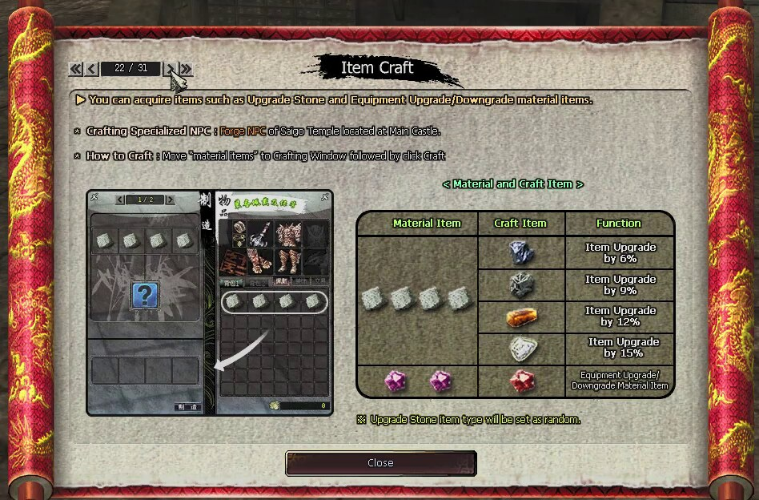

At the Armorer [Forge NPC]. Drag material items into the crafting window and click Craft. Produces Alloys [upgrade stones] and Mark materials; the Alloy grade rolled is random.

| Materials | Craft result | Function |
| --- | --- | --- |
| 4 grey stones | Alloy II [grey stone] | Temper +6% |
| 4 grey stones | Alloy III [dark stone] | Temper +9% |
| 4 grey stones | Alloy IV [amber stone] | Temper +12% |
| 4 grey stones | Alloy V [white stone] | Temper +15% |
| 2 purple jade | Mark Stone [red jade] | Gear rank up / down material |

### Page 23: Tempering [Item Upgrade]

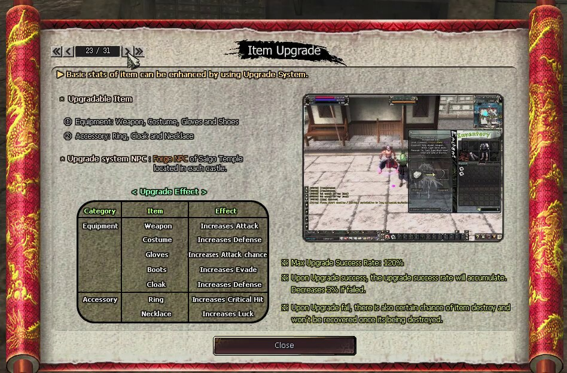

- Tempering [Item Upgrade]: weapon, armor [costume], gloves, boots [shoes] (equipment); ring, cape [cloak], amulet [necklace] (accessory). At the Armorer in the Central Plaza and each Home City.
- Max success rate 120%. Each success adds to the success rate; each fail subtracts 3%.
- A fail has a chance to destroy the item, with no recovery.

| Slot | Tempering raises |
| --- | --- |
| Weapon | Attack |
| Armor | Defense |
| Gloves | Hit Rate |
| Boots | Evasion |
| Cape | Defense |
| Ring | Critical |
| Amulet | Luck |

### Page 24: Fusion [Item Combine]

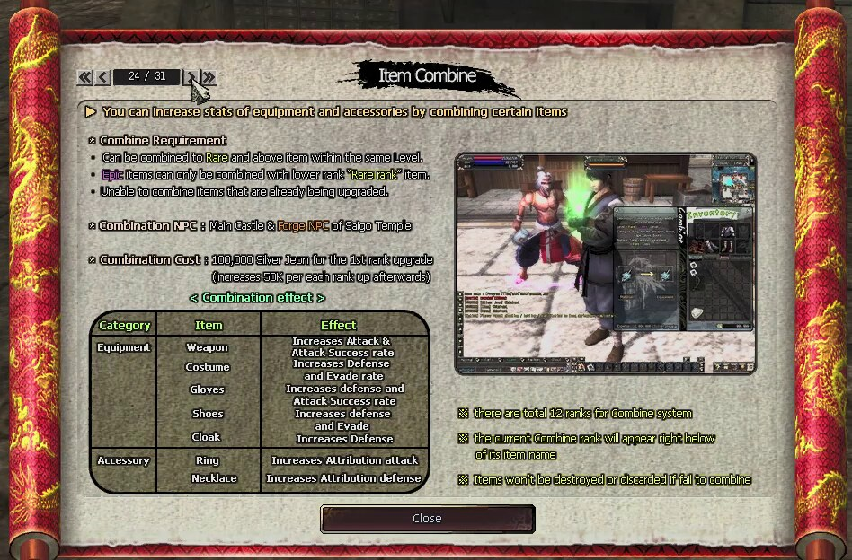

- Fusion [Item Combine]: Rare and above only, same item level only. Epic can only fuse with a lower-rank Rare. Cannot fuse an item that has already been Tempered.
- At the Armorer in the Home City and Central Plaza. Cost 100,000 Creds for FS1, +50,000 per stage after.
- 12 stages. Current stage shows under the item name. Fails never destroy or discard the item.

| Slot | Fusion raises |
| --- | --- |
| Weapon | Attack and Hit Rate |
| Armor | Defense and Evasion |
| Gloves | Defense and Hit Rate |
| Boots | Defense and Evasion |
| Cape | Defense |
| Ring | Elemental attack |
| Amulet | Elemental defense |

### Page 25: Item Exchange (reroll item type)

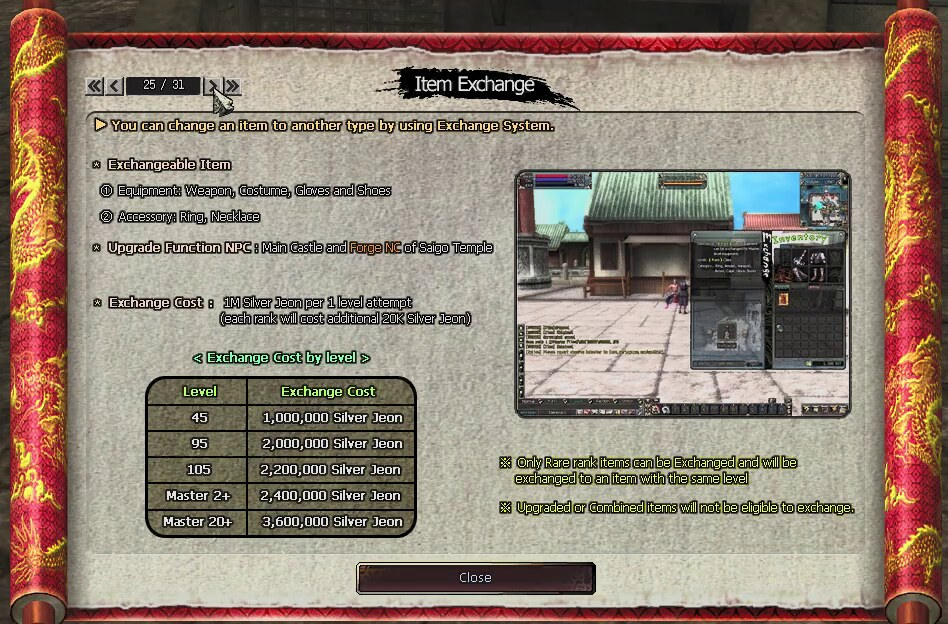

- Item Exchange (12Sky only; nearest Krytical Nova system is the Epic Mark upgrade): changes an item into another item of the same level. Weapon, armor, gloves, boots, ring, amulet. At the Armorer.
- Rare only; Tempered or Fused items cannot be exchanged.
- Cost 1M Creds per attempt, +20k per rank:

| Item level | Exchange cost (Creds) |
| --- | --- |
| 45 | 1,000,000 |
| 95 | 2,000,000 |
| 105 | 2,200,000 |
| Prime 2+ | 2,400,000 |
| Prime 20+ | 3,600,000 |

### Page 26: Gear rank up / down [nearest: Epic Mark upgrade]

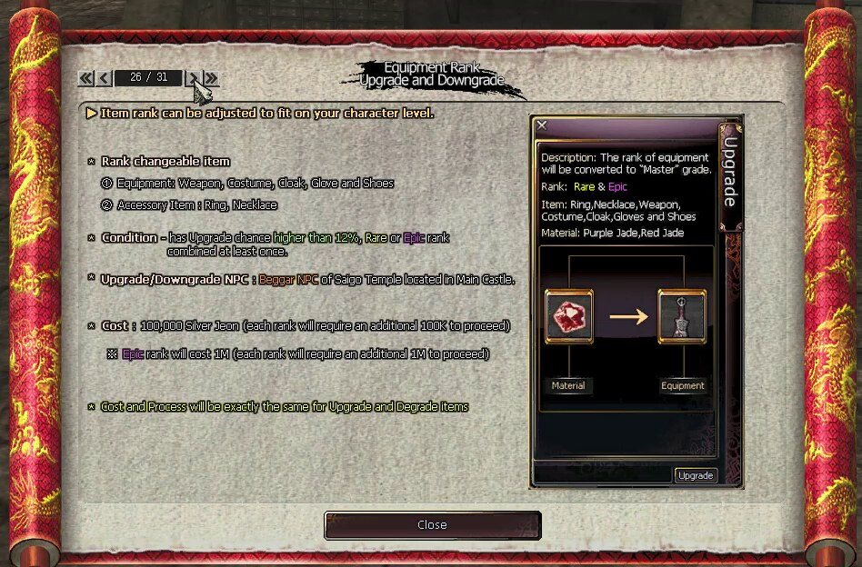

- Gear rank up / down (12Sky; Krytical Nova equivalent is the Epic Mk I → Mk II upgrade): moves an item's rank to fit the character level. Weapon, armor, cape, gloves, boots, ring, amulet.
- Condition: Temper above 12%, Rare or Epic, Fused at least once.
- At the Fixer [Beggar NPC] in the Central Plaza. Material: purple jade and Mark Stone [red jade]. Cost 100,000 Creds per rank (+100k per further rank); Epic costs 1M per rank (+1M per further rank). Up and down cost the same.

## Pages 27–31: Nova Store, Crew, Dossiers, Warden, Accord

### Page 27: Nova Store [Item Shop / Item Mall]

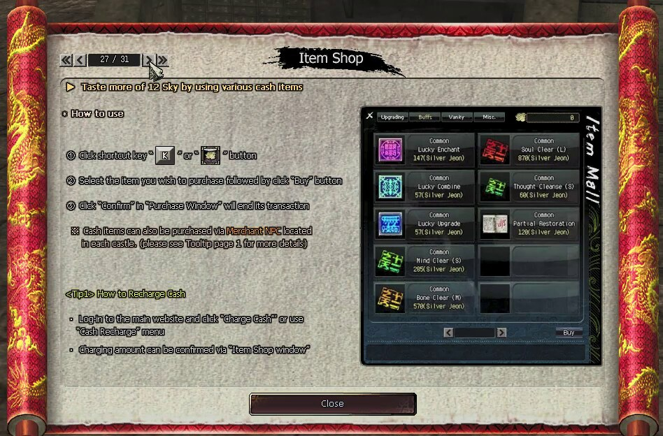

- Nova Store [Item Shop / Item Mall]: open with K or the shop button. Tabs: Upgrading, Buffs, Vanity, Misc. In Krytical Nova this store is real-money only.
- Select an item, click Buy, confirm in the purchase window. Cash items can also be bought from the Store Clerk [Merchant NPC] in each Home City.
- Recharge by logging into the website and choosing Charge Cash; the balance shows in the store window.
- Items visible on screen: Lucky Enchant (147), Lucky Combine (57), Lucky Upgrade (57), Mind Clear S (285), Bone Clear M (570), Soul Clear L (870), Thought Cleanse S (68), Partial Restoration (120).

### Page 28: Crew create [Guild]

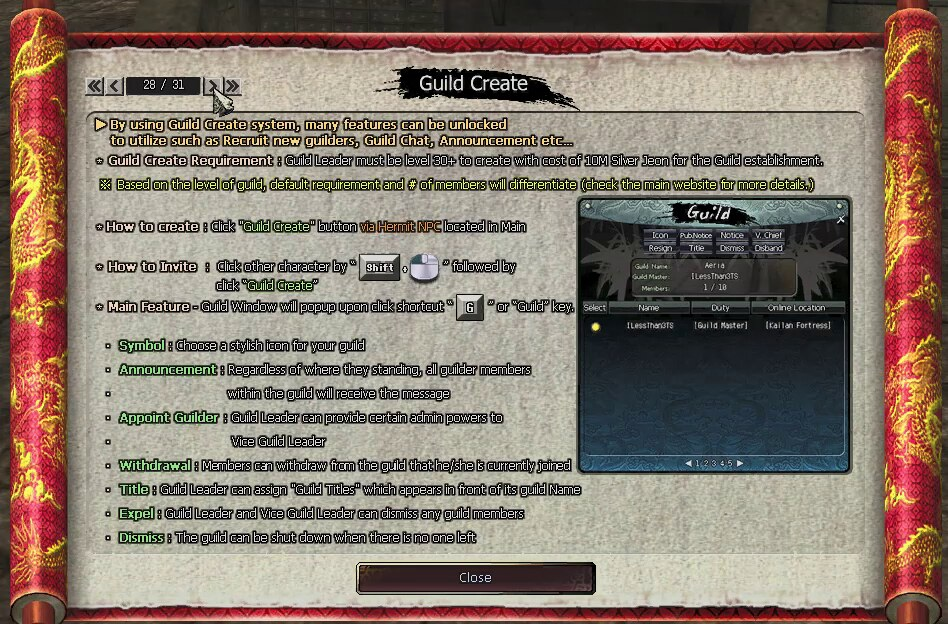

- Crew [Guild]: leader must be level 30+; costs 10M Creds. Default requirements and member cap scale with Crew level.
- Create at the Vaultkeeper [Hermit NPC] in the Home City. Invite: Shift + click a player, choose Crew Invite. G opens the Crew window.
- Features: Symbol (icon), Announcement (reaches all members anywhere), Appoint Officer [Guilder] (vice leader with admin powers), Withdrawal (member leaves), Crew Title (leader assigns a title shown in front of the name), Expel (leader and officers can dismiss members), Disband (Crew shuts down when empty).
- Crew window tabs: Icon, PubNotice, Notice, V.Chief, Resign, Title, Dismiss, Disband; member list shows name, duty, online location.

### Page 29: Dossier crafting [Craft Scrolls]

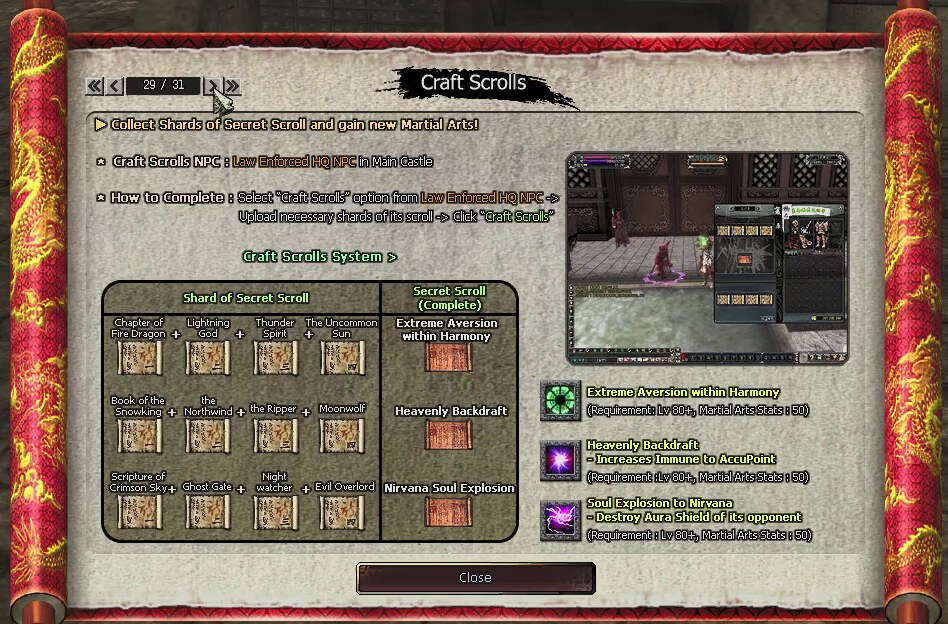

Dossier crafting [Craft Scrolls] at the Chancellor [Law Enforced HQ NPC]: choose Craft, upload the Pages [shards], click Craft. Each Dossier needs 4 Pages. Requirements: level 80+, skill stat 50. In the repo these are the Archives that unlock Heavenly Repulsion, Heavenly Destruction and Reverse Flow.

| Pages (4) [shards] | Dossier [secret scroll] | Skill |
| --- | --- | --- |
| Chapter of Fire Dragon + Lightning God + Thunder Spirit + The Uncommon Sun | Extreme Aversion within Harmony | (effect not stated on the page) |
| Book of the Snowking + the Northwind + the Ripper + Moonwolf | Heavenly Backdraft | Increases Lockup [paralysis] immunity |
| Scripture of Crimson Sky + Ghost Gate + Night Watcher + Evil Overlord | Nirvana Soul Explosion | Destroys the opponent's aura shield |

### Page 30: Warden [Leader of Grand Force]

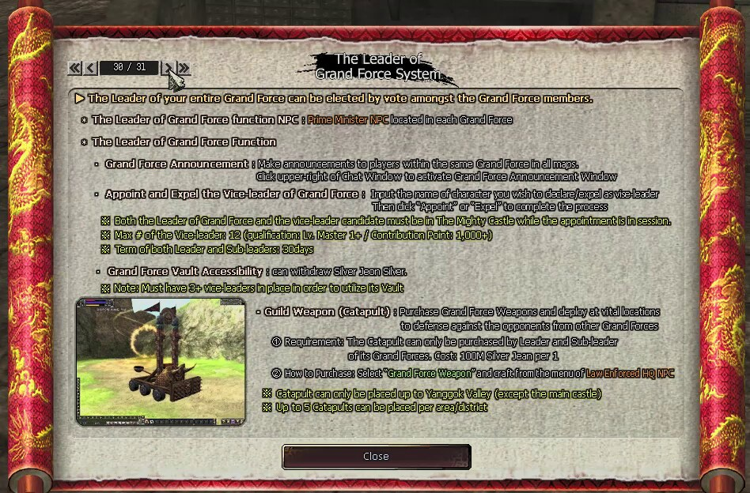

- Warden [Leader of Grand Force] elected by vote among faction members, through the Chancellor [Prime Minister NPC] in each faction.
- Powers: faction-wide announcement (all maps); appoint or expel Lieutenants [vice leaders] (max 12; must be Prime 1+ with 1,000+ Renown; both must be in the Home City during appointment). Term for Warden and Lieutenants: 30 days.
- War Chest [faction vault]: Warden can withdraw Creds; needs 3+ Lieutenants in place.
- Siege Rig [catapult / Guild Weapon]: Warden or Lieutenant buys from the Chancellor menu, 100M Creds each, place at key defensive spots. Only up to The Scar [Yanggok Valley], not the Home City; max 5 per area / district.

### Page 31: Accord [Alliance]

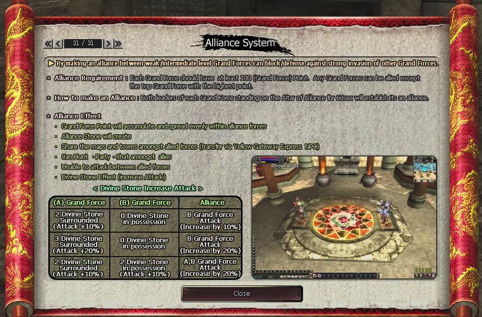

- Accord [Alliance]: weak or mid factions ally to defend against a strong one. Each faction needs 100+ faction points; any faction can ally except the top-scoring one.
- Form: both Wardens stand on the Altar of Accord for 60 seconds.
- Effects: faction points accumulate and spread evenly across the Accord; an Accord Beacon [Alliance Stone] is created; shared maps and towns (Transit via the Wayfinder); can hunt, Squad and chat together; cannot attack allies; Beacon [Divine Stone] attack bonus.

| Faction A | Faction B | Accord attack bonus |
| --- | --- | --- |
| 2 Beacons (+10%) | 0 | B gets +10% |
| 3 Beacons (+20%) | 0 | B gets +20% |
| 2 Beacons (+10%) | 2 Beacons (+10%) | A and B get +20% |
